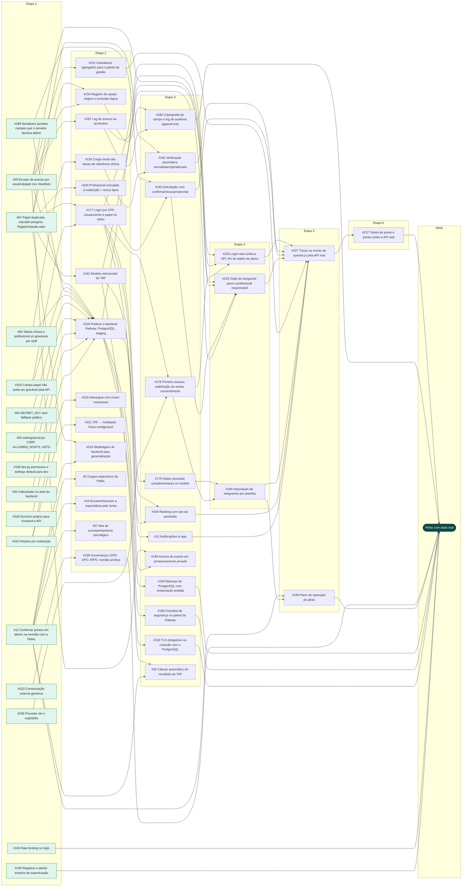

# Dependências entre issues

Mapa do que bloqueia o quê nas issues abertas, da primeira etapa (pode começar hoje) até a meta **piloto com dado real**. Retrato de 12/11/2026, com 59 issues abertas.

> As dependências foram inferidas do texto das issues e do código; não são um campo do GitHub. Se uma seta estiver errada, corrija este arquivo no mesmo PR.

## Regra para quem vai codar (pessoa ou agente)

Antes de começar qualquer issue:

1. Ache a issue nas tabelas abaixo e leia a coluna **Bloqueada por**.
2. Confira o estado real de cada bloqueio, porque este arquivo pode estar atrasado: `gh issue view <número> --json state`.
3. Se algum bloqueio ainda estiver aberto, **não comece**: avise quem pediu e proponha fazer o bloqueio primeiro. Só siga adiante com confirmação explícita.
4. Se a issue não estiver neste arquivo, ela é nova: descubra do que ela depende e acrescente-a aqui antes de codar.

Ao terminar:

5. No PR que fecha uma issue, remova a linha dela, tire o número das colunas das outras linhas e apague o nó e as setas dela no diagrama.
6. Ao abrir uma issue nova, acrescente a linha na etapa certa (uma etapa depois do bloqueio mais tardio) e as setas no diagrama.

## Caminho mais longo

[#67](https://github.com/Dom1ng0s/RastrIA/issues/67) → [#177](https://github.com/Dom1ng0s/RastrIA/issues/177) → [#178](https://github.com/Dom1ng0s/RastrIA/issues/178) → [#226](https://github.com/Dom1ng0s/RastrIA/issues/226) → [#227](https://github.com/Dom1ng0s/RastrIA/issues/227) → [#237](https://github.com/Dom1ng0s/RastrIA/issues/237) → **Meta**

É a cadeia que define o prazo mínimo: mesmo com o time em paralelo, estas acontecem uma depois da outra.

## Etapas

### Etapa 1 — pode começar agora

| Issue | Título | Área | Bloqueada por | Libera |
|---|---|---|---|---|
| [#62](https://github.com/Dom1ng0s/RastrIA/issues/62) | collectstatic no start do backend | Deploy | — | [#229](https://github.com/Dom1ng0s/RastrIA/issues/229) |
| [#63](https://github.com/Dom1ng0s/RastrIA/issues/63) | settings/prod.py: CSRF, ALLOWED_HOSTS, HSTS | Deploy | — | [#229](https://github.com/Dom1ng0s/RastrIA/issues/229) |
| [#108](https://github.com/Dom1ng0s/RastrIA/issues/108) | dev.py permissivo e settings default para dev | Deploy | — | [#229](https://github.com/Dom1ng0s/RastrIA/issues/229) |
| [#228](https://github.com/Dom1ng0s/RastrIA/issues/228) | Domínio próprio para frontend e API `blocker` | Deploy | — | [#229](https://github.com/Dom1ng0s/RastrIA/issues/229) |
| [#236](https://github.com/Dom1ng0s/RastrIA/issues/236) | Provedor de e-mail/SMS | Deploy | — | [#178](https://github.com/Dom1ng0s/RastrIA/issues/178) |
| [#222](https://github.com/Dom1ng0s/RastrIA/issues/222) | Rótulos por instituição | Generalização | — | [#220](https://github.com/Dom1ng0s/RastrIA/issues/220), [#221](https://github.com/Dom1ng0s/RastrIA/issues/221) |
| [#223](https://github.com/Dom1ng0s/RastrIA/issues/223) | Comunicação externa genérica | Generalização | — | [#238](https://github.com/Dom1ng0s/RastrIA/issues/238) |
| [#67](https://github.com/Dom1ng0s/RastrIA/issues/67) | Papel duplicado, cascade perigoso, RegistroSaude.valor | Modelagem | — | [#177](https://github.com/Dom1ng0s/RastrIA/issues/177), [#181](https://github.com/Dom1ng0s/RastrIA/issues/181), [#182](https://github.com/Dom1ng0s/RastrIA/issues/182), [#224](https://github.com/Dom1ng0s/RastrIA/issues/224), [#230](https://github.com/Dom1ng0s/RastrIA/issues/230), [#234](https://github.com/Dom1ng0s/RastrIA/issues/234) |
| [#12](https://github.com/Dom1ng0s/RastrIA/issues/12) | Confirmar pontos em aberto na reunião com a PMAL | PMAL | — | [#5](https://github.com/Dom1ng0s/RastrIA/issues/5), [#16](https://github.com/Dom1ng0s/RastrIA/issues/16), [#30](https://github.com/Dom1ng0s/RastrIA/issues/30), [#57](https://github.com/Dom1ng0s/RastrIA/issues/57), [#224](https://github.com/Dom1ng0s/RastrIA/issues/224), [#239](https://github.com/Dom1ng0s/RastrIA/issues/239) |
| [#59](https://github.com/Dom1ng0s/RastrIA/issues/59) | Escopo de acesso por usuário/papel nos ViewSets `blocker` | Segurança | — | [#185](https://github.com/Dom1ng0s/RastrIA/issues/185), [#187](https://github.com/Dom1ng0s/RastrIA/issues/187), [#229](https://github.com/Dom1ng0s/RastrIA/issues/229), [#231](https://github.com/Dom1ng0s/RastrIA/issues/231), [#233](https://github.com/Dom1ng0s/RastrIA/issues/233), [#234](https://github.com/Dom1ng0s/RastrIA/issues/234) |
| [#60](https://github.com/Dom1ng0s/RastrIA/issues/60) | Tabela clínica e profissional só graváveis por staff | Segurança | — | [#229](https://github.com/Dom1ng0s/RastrIA/issues/229), [#235](https://github.com/Dom1ng0s/RastrIA/issues/235) |
| [#64](https://github.com/Dom1ng0s/RastrIA/issues/64) | SECRET_KEY sem fallback público | Segurança | — | [#229](https://github.com/Dom1ng0s/RastrIA/issues/229) |
| [#103](https://github.com/Dom1ng0s/RastrIA/issues/103) | Campo papel não pode ser gravável pela API `blocker` | Segurança | — | [#177](https://github.com/Dom1ng0s/RastrIA/issues/177), [#229](https://github.com/Dom1ng0s/RastrIA/issues/229) |
| [#104](https://github.com/Dom1ng0s/RastrIA/issues/104) | Rate limiting no login | Segurança | — | **Meta** |
| [#189](https://github.com/Dom1ng0s/RastrIA/issues/189) | Serializers aceitam campos que o servidor deveria definir `blocker` | Segurança | — | [#183](https://github.com/Dom1ng0s/RastrIA/issues/183), [#229](https://github.com/Dom1ng0s/RastrIA/issues/229) |
| [#195](https://github.com/Dom1ng0s/RastrIA/issues/195) | Registrar e alertar eventos de autenticação | Segurança | — | **Meta** |

### Etapa 2

| Issue | Título | Área | Bloqueada por | Libera |
|---|---|---|---|---|
| [#177](https://github.com/Dom1ng0s/RastrIA/issues/177) | Login por CPF, /usuarios/me e papel no token | Backend | [#67](https://github.com/Dom1ng0s/RastrIA/issues/67), [#103](https://github.com/Dom1ng0s/RastrIA/issues/103) | [#31](https://github.com/Dom1ng0s/RastrIA/issues/31), [#178](https://github.com/Dom1ng0s/RastrIA/issues/178), [#179](https://github.com/Dom1ng0s/RastrIA/issues/179), [#184](https://github.com/Dom1ng0s/RastrIA/issues/184), [#226](https://github.com/Dom1ng0s/RastrIA/issues/226) |
| [#187](https://github.com/Dom1ng0s/RastrIA/issues/187) | Log de acesso ao prontuário | Backend | [#59](https://github.com/Dom1ng0s/RastrIA/issues/59) | [#186](https://github.com/Dom1ng0s/RastrIA/issues/186), [#233](https://github.com/Dom1ng0s/RastrIA/issues/233) |
| [#231](https://github.com/Dom1ng0s/RastrIA/issues/231) | Indicadores agregados para o painel da gestão | Backend | [#59](https://github.com/Dom1ng0s/RastrIA/issues/59) | [#227](https://github.com/Dom1ng0s/RastrIA/issues/227) |
| [#235](https://github.com/Dom1ng0s/RastrIA/issues/235) | Carga inicial das faixas de referência clínica | Backend | [#60](https://github.com/Dom1ng0s/RastrIA/issues/60) | [#182](https://github.com/Dom1ng0s/RastrIA/issues/182) |
| [#229](https://github.com/Dom1ng0s/RastrIA/issues/229) | Publicar o backend: Railway, PostgreSQL, staging `blocker` | Deploy | [#59](https://github.com/Dom1ng0s/RastrIA/issues/59), [#60](https://github.com/Dom1ng0s/RastrIA/issues/60), [#62](https://github.com/Dom1ng0s/RastrIA/issues/62), [#63](https://github.com/Dom1ng0s/RastrIA/issues/63), [#64](https://github.com/Dom1ng0s/RastrIA/issues/64), [#103](https://github.com/Dom1ng0s/RastrIA/issues/103), [#108](https://github.com/Dom1ng0s/RastrIA/issues/108), [#189](https://github.com/Dom1ng0s/RastrIA/issues/189), [#228](https://github.com/Dom1ng0s/RastrIA/issues/228) | [#185](https://github.com/Dom1ng0s/RastrIA/issues/185), [#193](https://github.com/Dom1ng0s/RastrIA/issues/193), [#194](https://github.com/Dom1ng0s/RastrIA/issues/194), [#198](https://github.com/Dom1ng0s/RastrIA/issues/198), [#226](https://github.com/Dom1ng0s/RastrIA/issues/226) |
| [#220](https://github.com/Dom1ng0s/RastrIA/issues/220) | Hierarquia com níveis nomeáveis | Generalização | [#222](https://github.com/Dom1ng0s/RastrIA/issues/222) | — |
| [#221](https://github.com/Dom1ng0s/RastrIA/issues/221) | TAF → Avaliação física configurável | Generalização | [#222](https://github.com/Dom1ng0s/RastrIA/issues/222) | — |
| [#224](https://github.com/Dom1ng0s/RastrIA/issues/224) | Modelagem de backend para generalização | Generalização | [#12](https://github.com/Dom1ng0s/RastrIA/issues/12), [#67](https://github.com/Dom1ng0s/RastrIA/issues/67) | — |
| [#238](https://github.com/Dom1ng0s/RastrIA/issues/238) | Governança LGPD: DPO, RIPD, revisão jurídica `blocker` | Governança | [#223](https://github.com/Dom1ng0s/RastrIA/issues/223) | **Meta** |
| [#181](https://github.com/Dom1ng0s/RastrIA/issues/181) | Modelo estruturado do TAF | Modelagem | [#67](https://github.com/Dom1ng0s/RastrIA/issues/67) | [#30](https://github.com/Dom1ng0s/RastrIA/issues/30), [#184](https://github.com/Dom1ng0s/RastrIA/issues/184), [#233](https://github.com/Dom1ng0s/RastrIA/issues/233) |
| [#230](https://github.com/Dom1ng0s/RastrIA/issues/230) | Profissional vinculado à instituição + novos tipos | Modelagem | [#67](https://github.com/Dom1ng0s/RastrIA/issues/67) | [#183](https://github.com/Dom1ng0s/RastrIA/issues/183) |
| [#234](https://github.com/Dom1ng0s/RastrIA/issues/234) | Registro de saúde: origem e exclusão lógica | Modelagem | [#59](https://github.com/Dom1ng0s/RastrIA/issues/59), [#67](https://github.com/Dom1ng0s/RastrIA/issues/67) | [#186](https://github.com/Dom1ng0s/RastrIA/issues/186) |
| [#5](https://github.com/Dom1ng0s/RastrIA/issues/5) | Cargos específicos da PMAL | PMAL | [#12](https://github.com/Dom1ng0s/RastrIA/issues/12) | — |
| [#16](https://github.com/Dom1ng0s/RastrIA/issues/16) | Encaminhamento a especialista pela Junta | PMAL | [#12](https://github.com/Dom1ng0s/RastrIA/issues/12) | — |
| [#57](https://github.com/Dom1ng0s/RastrIA/issues/57) | Aba de acompanhamento psicológico | PMAL | [#12](https://github.com/Dom1ng0s/RastrIA/issues/12) | — |

### Etapa 3

| Issue | Título | Área | Bloqueada por | Libera |
|---|---|---|---|---|
| [#31](https://github.com/Dom1ng0s/RastrIA/issues/31) | Notificações in-app | Backend | [#177](https://github.com/Dom1ng0s/RastrIA/issues/177) | [#227](https://github.com/Dom1ng0s/RastrIA/issues/227) |
| [#178](https://github.com/Dom1ng0s/RastrIA/issues/178) | Primeiro acesso, redefinição de senha, consentimento | Backend | [#177](https://github.com/Dom1ng0s/RastrIA/issues/177), [#236](https://github.com/Dom1ng0s/RastrIA/issues/236) | [#180](https://github.com/Dom1ng0s/RastrIA/issues/180), [#226](https://github.com/Dom1ng0s/RastrIA/issues/226) |
| [#182](https://github.com/Dom1ng0s/RastrIA/issues/182) | Verificação automática normal/atenção/alterado | Backend | [#67](https://github.com/Dom1ng0s/RastrIA/issues/67), [#235](https://github.com/Dom1ng0s/RastrIA/issues/235) | [#227](https://github.com/Dom1ng0s/RastrIA/issues/227) |
| [#183](https://github.com/Dom1ng0s/RastrIA/issues/183) | Solicitação com confirmar/recusar/cancelar | Backend | [#189](https://github.com/Dom1ng0s/RastrIA/issues/189), [#230](https://github.com/Dom1ng0s/RastrIA/issues/230) | [#227](https://github.com/Dom1ng0s/RastrIA/issues/227), [#233](https://github.com/Dom1ng0s/RastrIA/issues/233) |
| [#184](https://github.com/Dom1ng0s/RastrIA/issues/184) | Ranking com opt-out persistido | Backend | [#177](https://github.com/Dom1ng0s/RastrIA/issues/177), [#181](https://github.com/Dom1ng0s/RastrIA/issues/181) | [#227](https://github.com/Dom1ng0s/RastrIA/issues/227) |
| [#185](https://github.com/Dom1ng0s/RastrIA/issues/185) | Anexos de exame em armazenamento privado | Backend | [#59](https://github.com/Dom1ng0s/RastrIA/issues/59), [#229](https://github.com/Dom1ng0s/RastrIA/issues/229) | — |
| [#193](https://github.com/Dom1ng0s/RastrIA/issues/193) | TLS obrigatório na conexão com o PostgreSQL | Deploy | [#229](https://github.com/Dom1ng0s/RastrIA/issues/229) | **Meta** |
| [#194](https://github.com/Dom1ng0s/RastrIA/issues/194) | Backups do PostgreSQL com restauração testada | Deploy | [#229](https://github.com/Dom1ng0s/RastrIA/issues/229) | **Meta** |
| [#198](https://github.com/Dom1ng0s/RastrIA/issues/198) | Checklist de segurança no painel do Railway | Deploy | [#229](https://github.com/Dom1ng0s/RastrIA/issues/229) | **Meta** |
| [#179](https://github.com/Dom1ng0s/RastrIA/issues/179) | Dados pessoais complementares no modelo | Modelagem | [#177](https://github.com/Dom1ng0s/RastrIA/issues/177) | [#180](https://github.com/Dom1ng0s/RastrIA/issues/180) |
| [#30](https://github.com/Dom1ng0s/RastrIA/issues/30) | Cálculo automático do resultado do TAF | PMAL | [#12](https://github.com/Dom1ng0s/RastrIA/issues/12), [#181](https://github.com/Dom1ng0s/RastrIA/issues/181) | — |
| [#186](https://github.com/Dom1ng0s/RastrIA/issues/186) | Criptografia de campo e log de auditoria append-only `blocker` | Segurança | [#187](https://github.com/Dom1ng0s/RastrIA/issues/187), [#234](https://github.com/Dom1ng0s/RastrIA/issues/234) | **Meta** |

### Etapa 4

| Issue | Título | Área | Bloqueada por | Libera |
|---|---|---|---|---|
| [#180](https://github.com/Dom1ng0s/RastrIA/issues/180) | Importação de integrantes por planilha | Backend | [#178](https://github.com/Dom1ng0s/RastrIA/issues/178), [#179](https://github.com/Dom1ng0s/RastrIA/issues/179) | [#227](https://github.com/Dom1ng0s/RastrIA/issues/227), [#239](https://github.com/Dom1ng0s/RastrIA/issues/239) |
| [#233](https://github.com/Dom1ng0s/RastrIA/issues/233) | Visão do integrante para o profissional responsável | Backend | [#59](https://github.com/Dom1ng0s/RastrIA/issues/59), [#181](https://github.com/Dom1ng0s/RastrIA/issues/181), [#183](https://github.com/Dom1ng0s/RastrIA/issues/183), [#187](https://github.com/Dom1ng0s/RastrIA/issues/187) | [#227](https://github.com/Dom1ng0s/RastrIA/issues/227) |
| [#226](https://github.com/Dom1ng0s/RastrIA/issues/226) | Login real contra a API, fim do atalho de demo | Frontend | [#177](https://github.com/Dom1ng0s/RastrIA/issues/177), [#178](https://github.com/Dom1ng0s/RastrIA/issues/178), [#229](https://github.com/Dom1ng0s/RastrIA/issues/229) | [#227](https://github.com/Dom1ng0s/RastrIA/issues/227) |

### Etapa 5

| Issue | Título | Área | Bloqueada por | Libera |
|---|---|---|---|---|
| [#227](https://github.com/Dom1ng0s/RastrIA/issues/227) | Trocar os mocks de queries.js pela API real | Frontend | [#31](https://github.com/Dom1ng0s/RastrIA/issues/31), [#180](https://github.com/Dom1ng0s/RastrIA/issues/180), [#182](https://github.com/Dom1ng0s/RastrIA/issues/182), [#183](https://github.com/Dom1ng0s/RastrIA/issues/183), [#184](https://github.com/Dom1ng0s/RastrIA/issues/184), [#226](https://github.com/Dom1ng0s/RastrIA/issues/226), [#231](https://github.com/Dom1ng0s/RastrIA/issues/231), [#233](https://github.com/Dom1ng0s/RastrIA/issues/233) | [#237](https://github.com/Dom1ng0s/RastrIA/issues/237) |
| [#239](https://github.com/Dom1ng0s/RastrIA/issues/239) | Plano de operação do piloto | Governança | [#12](https://github.com/Dom1ng0s/RastrIA/issues/12), [#180](https://github.com/Dom1ng0s/RastrIA/issues/180) | **Meta** |

### Etapa 6

| Issue | Título | Área | Bloqueada por | Libera |
|---|---|---|---|---|
| [#237](https://github.com/Dom1ng0s/RastrIA/issues/237) | Testes de ponta a ponta contra a API real | Frontend | [#227](https://github.com/Dom1ng0s/RastrIA/issues/227) | **Meta** |

### Meta — piloto com dado real

Bloqueada por: [#104](https://github.com/Dom1ng0s/RastrIA/issues/104), [#186](https://github.com/Dom1ng0s/RastrIA/issues/186), [#193](https://github.com/Dom1ng0s/RastrIA/issues/193), [#194](https://github.com/Dom1ng0s/RastrIA/issues/194), [#195](https://github.com/Dom1ng0s/RastrIA/issues/195), [#198](https://github.com/Dom1ng0s/RastrIA/issues/198), [#237](https://github.com/Dom1ng0s/RastrIA/issues/237), [#238](https://github.com/Dom1ng0s/RastrIA/issues/238), [#239](https://github.com/Dom1ng0s/RastrIA/issues/239).

## Sem dependências

Não bloqueiam nem esperam outra issue.

| Issue | Título | Área | Observação |
|---|---|---|---|
| [#68](https://github.com/Dom1ng0s/RastrIA/issues/68) | CI e matriz de permissão (já existe no repositório) | Chore | Provavelmente concluída: conferir e fechar |
| [#105](https://github.com/Dom1ng0s/RastrIA/issues/105) | Refresh token revogável (blacklist já implementada) | Segurança | Provavelmente concluída: conferir e fechar |
| [#109](https://github.com/Dom1ng0s/RastrIA/issues/109) | Proteger o Django admin (rate limit, 2FA, rede) | Segurança |  |
| [#110](https://github.com/Dom1ng0s/RastrIA/issues/110) | Lockfile e hash pinning do requirements.txt | Segurança |  |
| [#196](https://github.com/Dom1ng0s/RastrIA/issues/196) | Argon2 como hasher de senha | Segurança |  |
| [#199](https://github.com/Dom1ng0s/RastrIA/issues/199) | launch.json versionado com caminho local | Chore |  |
| [#200](https://github.com/Dom1ng0s/RastrIA/issues/200) | Guia descreve auth por CPF que não existe | Chore |  |
| [#232](https://github.com/Dom1ng0s/RastrIA/issues/232) | Endpoints de contato institucional e reporte de problema | Backend |  |
| [#241](https://github.com/Dom1ng0s/RastrIA/issues/241) | Página não importa de outra página: tirar navItems dos dashboards | Frontend |  |
| [#240](https://github.com/Dom1ng0s/RastrIA/issues/240) | Alinhar fluxo de branches com o documentado | Chore |  |

## Diagrama

Setas apontam do bloqueio para a issue bloqueada. Em verde, o que pode começar agora.

